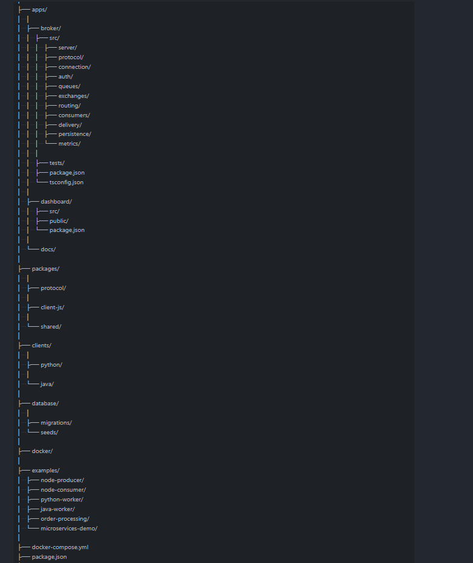
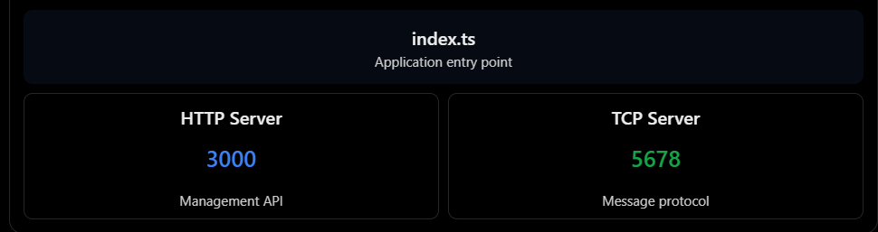
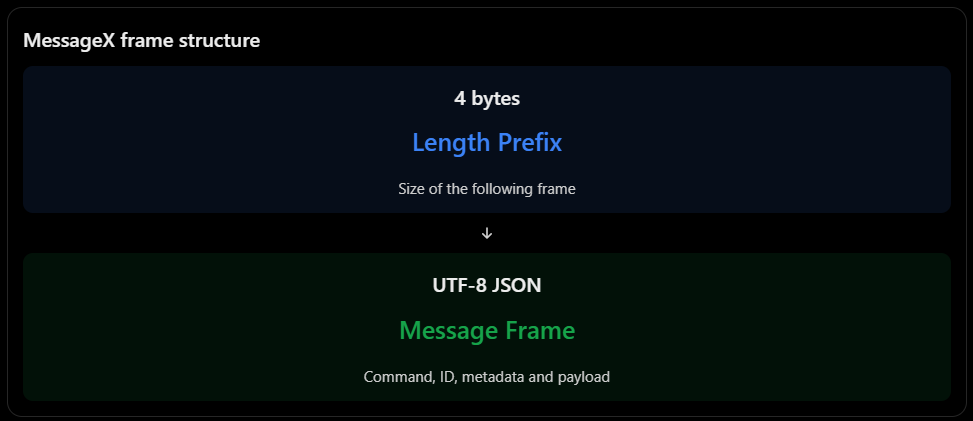
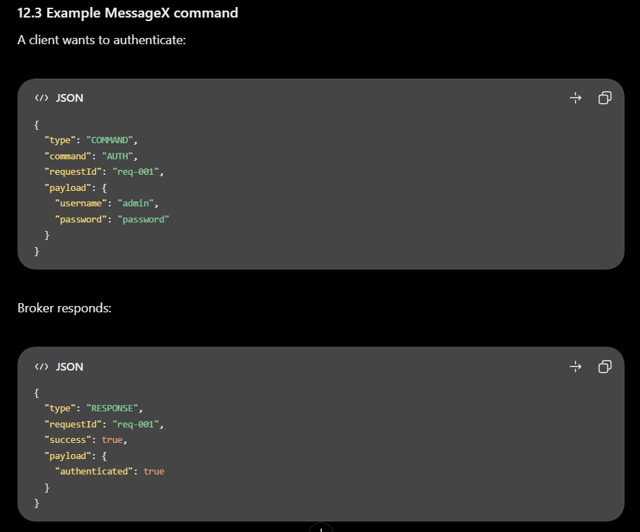
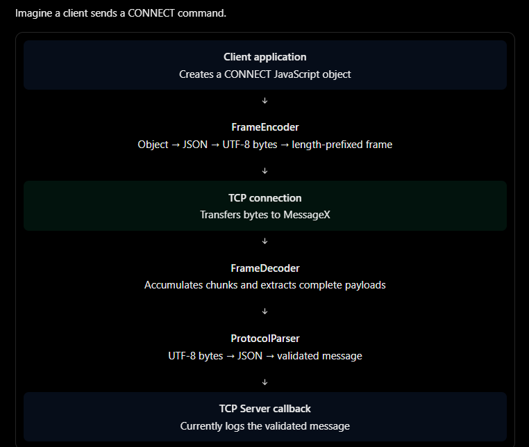

# Different components of MessageX      

                         MESSAGE X
                             │
              ┌──────────────┴──────────────┐
              │                             │
              ▼                             ▼
       Management Side                Message Side
              │                             │
        React Dashboard                SDKs
              │                       JS / Python / Java
              │                             │
        Express API                       TCP
              │                             │
              ▼                             ▼
         PostgreSQL                  MessageX Broker
                                            │
                              ┌─────────────┼─────────────┐
                              ▼             ▼             ▼
                           Exchange      Exchange      Exchange
                              │             │             │
                              ▼             ▼             ▼
                           Queue         Queue         Queue
                              │             │             │
                              ▼             ▼             ▼
                          Consumer      Consumer      Consumer

# Database Postgresql Role : 

                     MessageX Broker
                       │
          ┌────────────┴────────────┐
          │                         │
     Runtime State             PostgreSQL
       (memory)                 (metadata)
          │                         │
          │                    users
          │                    queues
          │                    exchanges
          │                    bindings
          │                    permissions
          │                    configuration
          │
     messages / consumers /
     connections / delivery

# project folder structure : 

# Role of apps/broker/src

Directory	Responsibility
server	        Start and stop TCP and HTTP servers
protocol	    Parse and validate MessageX frames
connection	    Manage TCP connections
auth	        Authenticate broker clients
queues	        Queue creation and message storage
exchanges	    Exchange management
routing	        Route messages to queues
consumer	    Manage registered consumers
delivery	    Deliver messages and handle acknowledgements
persistence	    PostgreSQL integration
metrics	        Broker monitoring
management	    Express routes, controllers and middleware

# HTTP Server vs TCP Server

## TCP Server helps maintain persistence connection between application and messageX broker

Application A
      │
      │ TCP connection
      ▼
MessageX TCP Server
      │
      │ Persistent connection
      ▼
Application B

# messagex protocol

messageX uses length-prefixed JSON instead of TCP frames
TCP might deliver the data in multiple chunks, or combine several messages into one chunk.
Therefore, we need our own framing mechanism.

Notice requestId.

It allows the SDK to match responses with their original requests, even when multiple requests are in progress on the same TCP connection. This is called request-response correlation.

